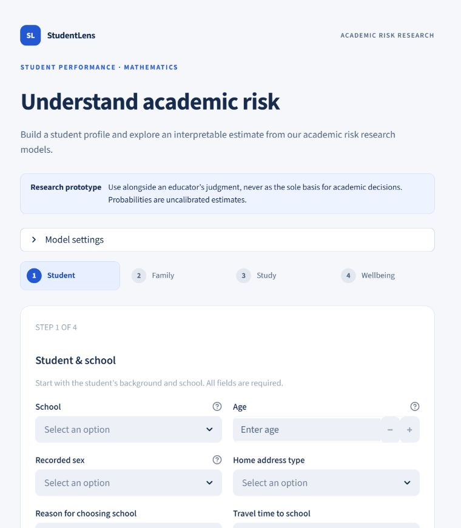

# Retrospective Student Academic Risk Classification Using Interpretable Machine Learning

Research manuscript and reproducible Python project by **Chirayu Singla, Yuvraj Singh, and Rajay Vedaraj I S**. Department of Computer Science and Engineering, Vellore Institute of Technology, Vellore, Tamil Nadu, India.

## Research overview and objectives

This study classifies final mathematics failure in the public UCI cohort while excluding all three grade columns from model inputs. It audits the preserved logistic-regression (LR) and decision-tree (DT) experiment and explores whether its conclusions hold under simple baselines, nested resampling, model diversity, feature exclusions, calibration diagnostics and subgroup analysis. Its contribution is a reproducible sensitivity assessment of a small retrospective classification task.

The problem is `At Risk = 1[G3 < 10]`. The objective is to describe discrimination, probability error, referral workload and uncertainty without implying that recorded predictors were available at a useful early cutoff. No independent institution, prospective cohort or intervention study is evaluated.

## Data and licence

Paulo Cortez (2008), [Student Performance](https://archive.ics.uci.edu/dataset/320/student+performance), DOI [10.24432/C5TG7T](https://doi.org/10.24432/C5TG7T), under [CC BY 4.0](https://creativecommons.org/licenses/by/4.0/). Mathematics: 395 rows, 33 original columns, 30 non-grade predictors, 130 failures and 265 passes, no missing values. The frozen split contains 316 training and 79 test rows (26 failures, 53 passes). Portuguese data are supplied as source material and are not pooled or used for external validation. Original data bytes and attribution are preserved in `data/` and `data/provenance.json`.

The repository previously had no project-wide licence. [LICENSE](LICENSE) records that fact and the scope of third-party permissions; it grants no new rights over author-owned code or manuscript. An open-source licence needs rights-holder approval before release.

## Methodology and model descriptions

Training-only pipelines impute numeric values by median and categories by mode, encode categories with first-level dropping, and scale numeric LR inputs. LR searches 16 configurations, DT 60, using stratified five-fold cross-validation, F2 selection with recall and ROC-AUC tie breaks, and optional balanced class weights. No SMOTE or synthetic records are used. The threshold stays 0.5. DT remains the application default selected using training CV. LR supplies grouped log-odds contributions; DT supplies the exact decision path and leaf support.

Random forest and gradient boosting each use a bounded four-configuration exploratory search. Repeated nested validation uses five outer folds repeated twice on only the original 316 training rows, with full five-fold inner retuning. Fold scores are dependent and are summarized by mean and sample SD, not independent confidence intervals.

## Verified results and baseline comparison

The following values are recalculated from saved probabilities and checked against fitted models. LR/DT are the original held-out experiment. RF/GB and all revision analyses are exploratory because the same test cohort was already examined.

| Model | Precision | Recall | F2 | ROC-AUC | AP | Brier |
|---|---|---|---|---|---|---|
| Logistic regression | 0.500 | 0.692 | 0.643 | 0.744 | 0.598 | 0.207 |
| Decision tree | 0.450 | 0.692 | 0.625 | 0.693 | 0.569 | 0.216 |
| Random forest | 0.583 | 0.538 | 0.547 | 0.723 | 0.676 | 0.209 |
| Gradient boosting | 0.647 | 0.423 | 0.455 | 0.721 | 0.564 | 0.197 |
| Majority | 0.000 | 0.000 | 0.000 | 0.500 | 0.329 | 0.329 |
| Always-At-Risk | 0.329 | 1.000 | 0.710 | 0.500 | 0.329 | 0.671 |
| Prevalence probability | 0.000 | 0.000 | 0.000 | 0.500 | 0.329 | 0.221 |
| Prior failure | 0.647 | 0.423 | 0.455 | 0.655 | 0.464 | 0.266 |

LR confusion matrix is [[35,18],[8,18]], DT [[31,22],[8,18]], in observed/predicted pass-fail order. Both identify 18/26 failures, with recall 0.692 and Wilson interval 0.500–0.835. LR flags 36/79 and DT 40/79 students. Always-At-Risk flags 79/79 and exceeds both on F2; the selective models improve precision and reduce workload. Majority matches LR accuracy while detecting no failures. AP denotes non-interpolated average precision. Smaller Brier scores are better.

## Calibration, subgroup analysis and ablations

Nested-search sigmoid ensembles use three training calibration folds. Their held-out recall falls to 2/26 = 0.077 at 0.5, despite Brier improving to 0.197 (LR) and 0.202 (DT), versus prevalence 0.221. These models are diagnostic extensions and are not substituted into the app.

Recorded sex, address and school slices retain positive and negative denominators and Wilson intervals. For LR, recorded-F false positives are 14/26 and recorded-M 4/27; DT gives 9/26 and 13/27. Recall uses 12/17 and 6/9 positives. These small, overlapping groups cannot establish fairness or transportable disparities.

Ablations retune LR/DT without absences, without failures, and using a defined reduced set of 15 inputs on identical outer folds. Outer-validation AP permutation importance and coefficient stability describe fitted associations. Results and figures are in [publication/results](publication/results) and [publication/figures](publication/figures). Class-stratified paired bootstrap intervals condition on this cohort, fixed models and observed prevalence; they omit retraining and school clustering.

## Research prototype

The Streamlit application guides profile entry, runs the original models and displays explanations and held-out evaluation. Inputs remain in session memory. Use fictional profiles when demonstrating; personal names are unnecessary for model inference. App tests demonstrate software behavior, not educational effectiveness.

## Limitations

The cohort is small and historical, with two schools, only 26 failing test students and unknown predictor timing. Total absences may include late-year information. Excluding grades or absences cannot establish prospective availability. No external validation, causal effect, operational fairness guarantee or student-outcome benefit is claimed. Future work requires timestamped prospective features, a predeclared cutoff, independent cohorts, contextual ethics review and evaluation of support outcomes.

## Reproduce on Windows Python 3.12.10

From the repository root, create a fresh environment with `powershell -NoProfile -ExecutionPolicy Bypass -File scripts/setup.ps1`. The setup script requires an installed Python 3.12 x64; an excluded local runtime is not needed by a fresh clone. Dependencies and the 52-package lock preserve the model environment. Do not copy an existing virtual environment between machines.

Run `.venv/Scripts/python.exe -m pip check`, `.venv/Scripts/python.exe -m src.doctor`, `.venv/Scripts/python.exe -m src.verify`, and `.venv/Scripts/python.exe -m pytest -q --basetemp .diagnostics/pytest-fresh`. Then run `.venv/Scripts/python.exe scripts/smoke_streamlit.py` and `.venv/Scripts/python.exe -m streamlit run app.py`.

To reproduce every publication extension without replacing saved evidence, set `$env:RISK_PUBLICATION_OUTPUT = Join-Path (Get-Location) '.diagnostics/publication-reproduction-20261102'` in PowerShell and run `.venv/Scripts/python.exe publication/source/run_experiments.py`. This executes original tuning, four model families, ten outer folds, retuned ablations, calibration ensembles and 2,000 paired stratified bootstrap samples; allow several minutes. Then run `.venv/Scripts/python.exe publication/source/audit_final.py`. Its fresh-run comparison covers scientific CSV columns and excludes nondeterministic search timings.

Saved-output verification alone: `.venv/Scripts/python.exe publication/source/verify_outputs.py` and `.venv/Scripts/python.exe publication/source/audit_final.py`. Read the JSON result: a fresh-rerun check is only present after that rerun completes. Source changes produce an expected historical-snapshot warning; preserve `models/training-source`.

The experiment dependencies are in `publication/reproducibility/requirements-experiments.txt`; the root lock also supports the app and tests. To regenerate the seven figures, run `.venv/Scripts/python.exe publication/source/make_figures.py` only in a disposable clone because it replaces the derived figure exports. To author the final package, use a separate document environment with `python-docx`, `reportlab`, `pypdf`, Pillow and a PDF renderer, run `publication/source/prepare_final.py`, then `publication/source/export_word.ps1 -Files publication/Final_IEEE_Access_Manuscript.docx`. Microsoft Word exports the matching PDF. Authoring is separate from model execution.

## Repository structure and evidence

- `src/`, `app.py`, `scripts/`, `tests/`: runnable original experiment, app and checks.
- `data/`, `models/`, `results/`: preserved dataset, original fitted models and evidence.
- `models/training-source/`: authenticated historical source snapshots.
- `publication/source/`: exploratory experiments, independent audit and final authoring source.
- `publication/results/`, `publication/tables/`, `publication/figures/`: full scientific evidence and manuscript assets.
- `publication/reproducibility/`: portable historical project snapshot and separate dependency lists; historical copies are intentional.
- `publication/final/`: new verification, reference and layout records.
- `notebooks/`: optional cleared exploration notebook; Jupyter is not needed to run the app.

## Manuscript, reports and publication status

Prepared for IEEE Access; **not submitted, accepted or published**. [Final manuscript PDF](publication/Final_IEEE_Access_Manuscript.pdf) · [editable DOCX](publication/Final_IEEE_Access_Manuscript.docx) · [Technical audit](publication/Final_Technical_Audit.pdf) · [Reproducibility report](publication/Final_Reproducibility_Report.pdf) · [Submission checklist](publication/IEEE_Access_Submission_Checklist.pdf) · [Results appendix](publication/Experiment_Results_Appendix.pdf) · [Release notes](Repository_Release_Notes.md).

Biographies, author declarations, ORCID details, correspondence confirmation and a code-licence decision remain author actions. The proposed v1.0.0 release is prepared locally; publication and Zenodo archival require approval. No project DOI has been assigned. Historical documents remain as provenance; use the `Final_` files for this revision.

## Citation and authors

Use [CITATION.cff](CITATION.cff) for the repository and cite the dataset separately. Suggested repository citation: Chirayu Singla, Yuvraj Singh, and Rajay Vedaraj I S, “Retrospective Student Academic Risk Classification Using Interpretable Machine Learning,” research software and manuscript preparation, https://github.com/ChirayuSingla/Student-academic-Risk-Predictor, accessed 2 November 2026. The intended release version is v1.0.0, currently unreleased; do not cite an invented journal volume or DOI.

Correspondence in the supplied manuscript: Rajay Vedaraj I S, rajay@vit.ac.in (author confirmation required). No author biography or institutional approval is inferred from affiliation.
